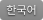

> [!WARNING]
> **OpenLogi is under active development** and not yet stable — features and config may still change. Give the repo a **Star** ⭐ and **Watch** 👀 it to get notified when a new release lands.

<p align="center">
    
</p>

<h1 align="center">OpenLogi</h1>
<p align="center"><strong>⚡️ A native, local-first alternative to Logitech Options+, written in Rust 🦀<br/>Unlock the full capabilities of Logitech mice, keyboards, and webcams over HID++ and UVC</strong></p>

<div align="center">
    <a href="https://github.com/AprilNEA/OpenLogi/releases/latest" target="_blank">
    </a>
    <a href="https://github.com/AprilNEA/OpenLogi/releases" target="_blank">
    </a>
    <a href="https://github.com/AprilNEA/OpenLogi/commits" target="_blank">
    </a>
    <a href="#license">
    </a>
    
</div>

<div align="center">
    <a href="https://x.com/AprilNEA" target="_blank">
    </a>
    <a href="https://t.me/+VDtkR5OSAT04NzVh" target="_blank">
    </a>
</div>

<div align="center">
    <a href="README.md">
    </a>
    <a href="docs/README.zh-CN.md">
    </a>
    <a href="docs/README.ja.md">
    </a>
    <a href="docs/README.de.md">
    </a>
    <a href="docs/README.fr.md">
    </a>
    <a href="docs/README.ko.md">
    </a>
    <a href="docs/README.ru.md">
    </a>
    <a href="docs/README.es.md">
    </a>
    <a href="docs/README.pt-BR.md">
    </a>
    <a href="docs/README.tr.md">
    </a>
</div>

<p align="center">
    <a href="https://trendshift.io/repositories/42303" target="_blank">
    </a>
    <a href="https://www.producthunt.com/products/openlogi?embed=true&amp;utm_source=badge-featured&amp;utm_medium=badge&amp;utm_campaign=badge-openlogi" target="_blank" rel="noopener noreferrer">
    <picture>
        <source media="(prefers-color-scheme: dark)" srcset="https://api.producthunt.com/widgets/embed-image/v1/top-post-badge.svg?post_id=openlogi&amp;theme=dark&amp;period=daily">
        <source media="(prefers-color-scheme: light)" srcset="https://api.producthunt.com/widgets/embed-image/v1/top-post-badge.svg?post_id=openlogi&amp;theme=light&amp;period=daily">
        
    </picture></a>
</p>

> **Fed up with Options+? Try OpenLogi.**

Runs on macOS, Linux, and Windows.

---

## Beyond Options+

Things OpenLogi does that Options+ won't:

- **Stay light.** Native Rust + GPUI.
- **Run on Linux.** Linux is a first-class platform in OpenLogi.
- **Gestures on supported buttons.** Assign gesture actions to supported controls — or turn gestures off entirely.
- **Plain-text config.** Everything is one TOML file you can sync between machines however you like.
- **Script it.** A real CLI alongside the GUI: a JSON [automation API](docs/USAGE.md#automation-api) for DPI, SmartShift, Fn-lock, and report rate, plus hardware diagnostics.

## Features

<p align="center">
    
</p>

### Devices

- Logi Bolt and Unifying receivers, Bluetooth, and wired connections, with battery level and charge state
- Low-battery notices at the bottom of the screen, once per discharge, with no OS notification permission
- An on-screen indicator when a keyboard turns Caps Lock on or off, plus Num Lock and Scroll Lock on Windows and Linux

<table>
    <tr>
        <td width="50%"></td>
        <td width="50%"><b>Easy-Switch</b><ul><li>See which computer is paired on each channel, with its OS and connection</li><li>Rename a channel on devices that allow it</li></ul></td>
    </tr>
</table>

### Buttons and actions

<table>
    <tr>
        <td width="50%"></td>
        <td width="50%"><b>Remap any button</b><ul><li>A built-in action catalog, custom shortcuts, typed text, or multi-step workflows</li><li>Separate tap and hold actions, and hold-to-talk chords that release with the button</li><li>Gestures on Middle Click, Back/Forward, DPI/ModeShift, the gesture button, and the haptic panel</li></ul></td>
    </tr>
    <tr>
        <td width="50%"></td>
        <td width="50%"><b>Actions Ring</b><ul><li>Eight actions in a ring around the cursor</li><li>Its own layout per application</li></ul></td>
    </tr>
    <tr>
        <td width="50%"></td>
        <td width="50%"><b>Keyboard keys</b><ul><li>Bind media, emoji, screenshot, and other dedicated keys like mouse buttons</li><li>Restore one key to its device default, or reset the whole row</li></ul></td>
    </tr>
</table>

Per-application profiles switch with the focused app. An `[apps]` alias lets one profile follow an application across platforms.

### Pointer and scrolling

<table>
    <tr>
        <td width="50%"></td>
        <td width="50%"><b>Pointer</b><ul><li>DPI presets with cycle and set-preset actions</li><li>Pointer speed and report rate</li><li>Precision Mode: one button switches the mouse to its slowest speed and back</li></ul></td>
    </tr>
    <tr>
        <td width="50%"></td>
        <td width="50%"><b>SmartShift</b><ul><li>Wheel mode and sensitivity</li><li>Scrolling force on SmartShift Enhanced mice</li><li>A permanent-ratchet switch</li></ul></td>
    </tr>
    <tr>
        <td colspan="2"><br><b>Scrolling</b><ul><li>Scroll inversion per device, natively or in software</li><li>Wheel resolution and smooth wheel scrolling</li><li>Hold Back or Forward and roll the wheel to scroll sideways on mice without a thumb wheel</li></ul></td>
    </tr>
</table>

### Keyboard and lighting

<table>
    <tr>
        <td width="50%"></td>
        <td width="50%"><b>Keyboard</b><ul><li>Fn Lock, and multi-platform keyboards that stay on the host OS layout</li><li>Backlight level, automatic brightness, and battery saving</li><li>The backlight level shown on screen as it changes</li><li>Static RGB on supported keyboards</li></ul></td>
    </tr>
    <tr>
        <td width="50%"></td>
        <td width="50%"><b>Litra lights</b><ul><li>Power, brightness, and color temperature</li><li>Turns on with the camera if you want</li><li>Keeps a change made on the light itself</li></ul></td>
    </tr>
</table>

### Webcams

- Any Logitech UVC webcam (Brio, StreamCam, the C920 series, …), plug and play
- Live preview that holds the camera only while you watch; leave it and the LED goes off
- Zoom, pan, tilt, focus, exposure, white balance, and every other UVC control, written to the hardware so Meet, Zoom, and OBS see the change
- Built-in Default / Streaming / Video call profiles plus your own snapshots, kept per camera

Feature coverage depends on what each device reports; the app shows only the controls a device supports.

### Platform support

| Feature | macOS | Windows | Linux |
| --- | --- | --- | --- |
| Mouse button remapping and gestures | ✓ | ✓ | ✓ |
| Keyboard F-key remapping | ✓ | ✓ | — |
| Per-application profiles | ✓ | ✓ | X11, wlroots (sway, Hyprland), GNOME with the [companion extension](crates/openlogi-hook/gnome-shell-extension/README.md) |
| Mouse profile follows the window under the pointer | ✓ | ✓ | X11 only |
| Media keys | Native | Native | D-Bus MPRIS |
| Brightness Up / Down actions | Native (built-in and Apple displays; for other displays use a tool like [MonitorControl](https://github.com/MonitorControl/MonitorControl)) | Not yet | Standard brightness keys; an external monitor needs a DDC/CI tool, see [the guide](docs/INSTALL-linux.md#brightness-keys-on-external-monitors) |
| Window-manager actions (desktops, Mission Control, …) | Native | Native equivalents | GNOME, KDE (KWin), Hyprland; some macOS-only actions do nothing |
| Menu-bar / tray icon | ✓ | ✓ | — |
| In-app updates | Sparkle | Built-in | Built-in |

## Install

> [!IMPORTANT]
> Quit **Logi Options+** (and Solaar on Linux) first. Only one application can own a receiver at a time.

| Platform | System | Architecture |
| --- | --- | --- |
| macOS | macOS 13 or later | Apple silicon, Intel |
| Linux | GLIBC 2.35 or newer | x86_64, arm64 |
| Windows | Tested on Windows 11 | x86_64, arm64 |

Every download carries a minisign signature and an entry in `SHA256SUMS`. To build from source, see [DEVELOPMENT.md](docs/DEVELOPMENT.md).

### macOS

<p>
    <a href="https://openlogi.org/download/mac-arm64"></a>
    &nbsp;
    <a href="https://openlogi.org/download/mac-x64"></a>
</p>

Or with Homebrew:

```sh
brew install --cask openlogi
```

Open OpenLogi and grant **Accessibility** and **Input Monitoring** when macOS asks. OpenLogi then updates itself through Sparkle.

### Linux

<p>
    <a href="https://openlogi.org/download/linux"></a>
    &nbsp;
    <a href="https://openlogi.org/download/linux-rpm"></a>
    &nbsp;
    <a href="https://openlogi.org/download/linux-arch"></a>
</p>

Or install the right package for your distribution with one command. It verifies the minisign signature and starts the agent; install `minisign` first:

```sh
curl -fsSL https://github.com/AprilNEA/OpenLogi/releases/latest/download/install.sh | sh
```

To read the script before running it, and for Flatpak, NixOS, and distributions without systemd, see [INSTALL-linux.md](docs/INSTALL-linux.md).

### Windows

<p>
    <a href="https://openlogi.org/download/windows"></a>
    &nbsp;
    <a href="https://openlogi.org/download/windows-zip"></a>
</p>

## Usage (CLI)

See [USAGE.md](docs/USAGE.md)

## Configuration

Settings use plain TOML; saves preserve symlinked config files. See
[CONFIGURATION.md](docs/CONFIGURATION.md).

## Developing

See [DEVELOPMENT.md](docs/DEVELOPMENT.md), including [macOS input-hook safety](docs/DEVELOPMENT.md#macos-input-hook-safety).

## Acknowledgments

- **Windows, cameras, and i18n** by [@davidbudnick](https://github.com/davidbudnick) — keyboard RGB, Windows support, Logitech webcam support
- **Linux port** by [@cserby](https://github.com/cserby) — Linux support
- [Solaar](https://github.com/pwr-Solaar/Solaar) by [@pwr](https://github.com/pwr) — open-source HID++ implementation
- [Mouser](https://github.com/TomBadash/Mouser) by [@TomBadash](https://github.com/TomBadash) — a local, account-free Options+ replacement

## License

The code in this repository is dual-licensed under either of

- Apache License, Version 2.0 ([LICENSE-APACHE](LICENSE-APACHE))
- MIT license ([LICENSE-MIT](LICENSE-MIT))

at your option.

### Third-party code

`crates/openlogi-hidpp` is a vendored fork of [`hidpp`](https://crates.io/crates/hidpp)
by [@lus](https://github.com/lus), licensed 0BSD.

### Logo & brand assets

Thanks to [@kubai087](https://github.com/kubai087) for designing the OpenLogi
logo. The OpenLogi logo and app icon (the brand assets under
[`design/`](design/)) are © 2026 AprilNEA, all rights reserved, and are not covered by the MIT/Apache
licenses above; see [`design/LICENSE`](design/LICENSE). Forking the code grants
no right to the OpenLogi name, logo, or icon; please don't use them to represent
your own projects, forks, or distributions without prior written permission.

---

**Not affiliated with Logitech.** "Logitech", "MX Master", and "Options+" are trademarks of Logitech International S.A.

## Repo activity


