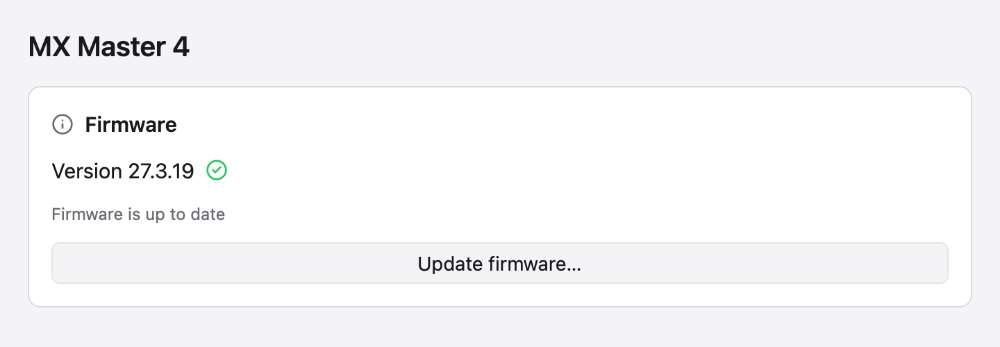
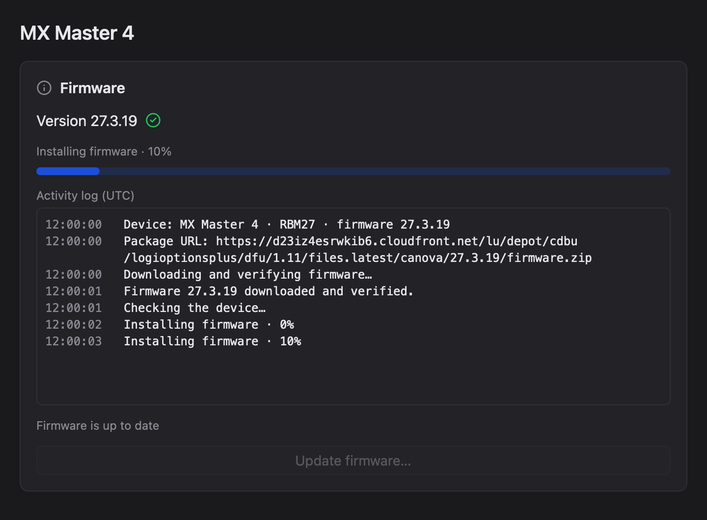
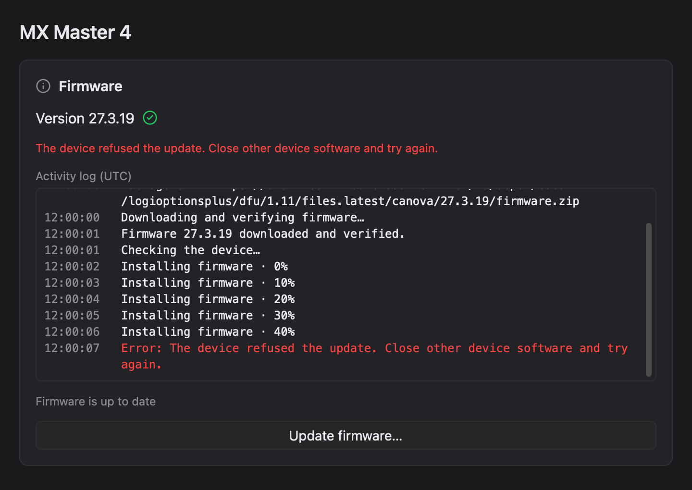

# Firmware updates

This document describes the updater implemented in OpenLogi and the remaining
work for discovering new releases. The protocol evidence and server observations
below were reviewed on 2026-10-23. Discovery, package authentication, and device
installation are separate responsibilities; finding a package does not establish
that OpenLogi can install it.

## Current support and limitations

OpenLogi currently installs the reviewed, unmodified MX Master 4 application
release **27.3.19**, for application PID `0xb042` and firmware line `RBM27`.
An older matching application can be updated; the exact current release can be
reinstalled after confirmation. A running version newer than the catalog is
refused rather than downgraded. Other PIDs, receiver firmware, classic DFU, and
other flash layouts are outside the current implementation.

The catalog is compiled into OpenLogi. There is no live release resolver,
scheduled discovery job, remote firmware index, or freshness timestamp yet.
Consequently, `FirmwareOffer::UpToDate` and the GUI's green check currently mean
**the running version matches the newest installable entry bundled with this
OpenLogi build**. They do not prove that Logitech has published nothing newer.
Reliable freshness reporting is outstanding work; see [release discovery](#release-discovery-proposed).

The development tests emulate HID++ responses. The original protocol experiment
successfully reinstalled the official image once on macOS through a Bolt receiver
on 2026-10-22: entity 2 was active before, entity 1 afterward, both reporting
27.3.19 afterward. That experiment used a separate research script, not the
integrated agent updater. It is evidence for the protocol, not validation of
every transport, platform, or failure recovery path of this implementation.

## Code owners

| Responsibility | Owner |
| --- | --- |
| Approved releases, product/firmware-line matching, URL, archive size and hash | [device-registry firmware catalog](../crates/openlogi-device-registry/src/firmware.rs) |
| Job admission, download, exclusive I/O ownership, shutdown, reconnect and terminal result | [agent firmware manager](../crates/openlogi-agent/src/firmware.rs) |
| Timestamped activity history, duplicate suppression and retention bound | [agent-core firmware history](../crates/openlogi-agent-core/src/firmware.rs) |
| Bounded HTTP download and whole-archive authentication before parsing | [agent downloader](../crates/openlogi-agent/src/firmware/download.rs) |
| Live inspection, preflight, inactive-bank selection, install and activation verification | [device firmware module](../crates/openlogi-device/src/firmware.rs) |
| RDFU structure and flash-range validation | [package parser](../crates/openlogi-device/src/firmware/package.rs) |
| Packet/block acknowledgement transitions | [transfer state machine](../crates/openlogi-device/src/firmware/transfer.rs) |
| HID++ `0x00D1` commands, status decoding and events | [resumable DFU feature](../crates/openlogi-hidpp/src/feature/dfu_resumable.rs) |
| Shared firmware status and installation-target decision | [core firmware types](../crates/openlogi-core/src/hid/firmware.rs) |
| Confirmation and progress presentation | [desktop firmware view](../crates/openlogi-desktop/src/app/detail/firmware.rs) |

The GUI is an IPC client. It does not download firmware or open a HID connection.
The agent owns the job after admission, independently of the requesting window
or IPC connection.

The installation confirmation shows a red warning above its buttons and disables
installation when the reported charge is below 30% or unavailable. It updates
with battery snapshots while open, and submission checks the current reading
again. The shared `FirmwareBatteryCharge` policy owns this percentage decision;
device preflight still reads and validates the live battery before any DFU start.

During installation, a compact scrollable activity log shows phase changes with
UTC timestamps and monospaced text. It includes the catalog's device family,
selected firmware version, official package URL, and a download-verification
entry. Transfer history advances in 10% milestones; live progress keeps its full
percentage precision. The agent retains up to 128 entries in the
job snapshot, including terminal failures. A GUI session retains its known
physical-device binding across reconnects to the same agent.
Pending local admissions also retain their device key if the connection drops
before the first job snapshot or admission reply arrives. An unavailable reply
is uncertain; a definite refusal cannot bind a later job. Snapshots do not
carry physical identity, so a cold GUI or a new agent run leaves historical
jobs unbound instead of assigning their progress to a device by route alone.
An unbound active job still blocks another installation.
Repeated identical phases do not add entries. Errors have an explicit error
label and use the theme's danger color. New entries follow the bottom unless
the user has scrolled up to read earlier activity. GPUI Kit's `MessageScroller`
owns native tail following and nested wheel routing. The fixed viewport is
12.6 rem high, and measured rows own vertical insets so padding is included in
the scroll extent. Following resumes when the reader returns to the bottom,
including when initially short content first overflows. The log remains available
after the job finishes and resets for the next job.

## UI examples

These native GPUI captures use the production firmware card with synthetic
presentation data. They illustrate the current-version, installation and failure
states; they do not exercise hardware or make network requests.







## Installation process

1. **Select an approved release.** Read HID++ `0x0003` on the agent's existing
   inventory channel. Match the active application prefix, firmware number and
   transport PID against the catalog. Permit only a current or newer approved
   release. Retain the route, original unit ID and approved release together in
   an opaque `FirmwareUpdateTarget` before downloading. The agent admits one
   firmware job at a time.
2. **Download and authenticate.** Fetch the catalog URL using HTTPS and platform
   trust roots, with connection and total-request deadlines and a byte bound.
   Require the exact archive length and SHA-256 before opening the ZIP. Locate
   exactly one `.rdfu` file and stream it in memory through the parser's 8 MiB
   container limit; archive paths are never extracted to disk.
3. **Validate the image.** Require the reviewed `RBM27` / `b042` dual-bank
   container, distinct payloads for entities 1 and 2, matching versions and init
   magic, aligned records, and supported record operations. Check every op-1
   flash write against its entity's address range: entity 1 is
   `[0x08000, 0x41000)` and entity 2 is `[0x41000, 0x7a000)`. These ranges are
   reverse-engineered for this layout, not a general Logitech flash map.
4. **Acquire exclusive access and preflight again.** The agent's firmware I/O
   operation pauses its capture activity and holds the receiver's exclusive
   lease and transport turn. Resolve the authoritative channel after waiting
   for ownership; do not open a competing connection. Re-read the device and
   require the admitted route and unit ID before any DFU start. A replacement
   device on the same route is refused. Require exactly two application banks
   with one active, and choose the other.
   Require known battery percentage of at least 30%, a Good/Full battery level
   and an accepted battery status. Require resumable and forcible `0x00D1`
   capabilities, and `NotStarted` for the selected entity. An unknown staged
   update is refused.
5. **Start and transfer.** Start with the target entity and image magic. Send
   raw 16-byte packets according to the device's Ready/Ack/Wait replies.
   If the start response is lost, query status within the same admitted
   transaction instead of issuing another start. Only the expected entity at
   block zero may begin transfer; `NotStarted` and other initial states fail
   without activation.
   The transfer state machine rejects unexpected entities, acknowledgements,
   skipped blocks and rewinds. A recovery query may request a retry of the exact
   packet whose write failed; ordinary replies must still advance. Wait for
   unsolicited status events, falling back to a status query when needed.
   Recovery queries and waits are bounded; a
   20-minute transfer deadline is checked between commands.
   Decode status from the actual wire payload: Ready and Wait require four
   bytes, and PacketAck requires six. Short responses fail as unsupported;
   truncated events are dropped before missing fields can become zeroes.
6. **Activate only after completion.** After the complete transfer is confirmed,
   send `ApplyDfu(entity, 0x02)`. This command causes a restart and does not echo
   a response. Drain the native write rather than treating the missing echo as
   a reason to resend it.
7. **Reconnect and verify.** Release the old channel and request inventory
   reconciliation. For up to 90 seconds, check the route, device unit ID,
   application PID, active target bank and exact target version. Publish success
   only after those checks pass. A timeout means activation was not confirmed;
   it does not establish that the old firmware is still running.

Native write futures must finish while the I/O lease remains held. Shutdown
signals a cooperative stop between commands and drains ownership before exit.
Do not wrap the whole flash in a cancellation timeout or abandon it when the
GUI disconnects. The deadline is not a guarantee that an in-flight native write
can be interrupted at exactly that instant.

Close other software that accesses the device, keep it awake and near its
receiver, and keep the computer awake during installation. OpenLogi's lease
coordinates its own I/O; it cannot prevent another application's HID traffic.
The original research script paused processes and used `caffeinate`; those
script mechanics are not the integrated agent's ownership mechanism.

## Authentication boundary

Before a release enters the compiled catalog, its ZIP must be independently
verified against Logitech's firmware-signing public key from Options+, its
`package.json` product/entity declarations reviewed, and installation validated
on the intended hardware. The current entry pins those reviewed ZIP bytes.

At runtime OpenLogi checks that pinned archive hash and length. It does **not**
fetch `.sigx` or perform a fresh RSA signature verification, and its downloader
does not independently interpret `package.json`. RDFU parsing and live-device
checks follow archive authentication. The compiled catalog is therefore the
runtime trust anchor; HTTPS or valid JSON alone is not approval to flash.

The implementation preserves the official image bytes. Neither the experiment
nor the updater tests establish how the bootloader rejects modified images or
whether it automatically falls back after a failed boot. Do not promise either
behavior, or describe every failed update as leaving the device unchanged.

## Release discovery (proposed)

The polling research identified these separate sources of information:

| Question | Evidence or owner |
| --- | --- |
| Which application is running? | Device firmware entities, HID++ `0x0003` |
| Where is this product's package? | Observed redirects from `updates.logitech.com` |
| Does a particular object exist? | Logitech's CDN response for that object |
| Is a package authentic and compatible? | Logitech's signature, package metadata and live device identity |
| Is a release the newest? | Release notes and discovery evidence; a bounded version scan cannot prove completeness |

In the 2026-10-23 probes, the resolver required a nonzero bootloader version;
requests should use the actual value. It also applied product-specific OS gates.
Redirect paths included both version templates and fixed package paths. Parse
the path independently of the echoed query string. The metadata request named
`latest.json` returned 403 in all tested variants; that is an observation, not
proof that Logitech has no other latest-release mechanism.

A templated redirect accepts arbitrary requested versions. Finding no object
within a revision/build window can miss a release outside that window. A fixed
redirect identifies a server-selected package, but its version and compatibility
still need verification. An unmapped probe is not conclusive evidence that a
product will never have updates. These are undocumented server behaviors and
can change without an OpenLogi release.

Discovery should live in a maintained producer rather than every desktop client:
resolve packages centrally, verify signatures and metadata, and publish an index
using the existing asset distribution infrastructure. Retain per-product
last-successful-check time, discovery coverage and source-health state; updating
a global generation timestamp must not make a failed product check look fresh.
Cross-check scans with release notes and known-package probes. Keep the last
verified entries when a check fails, while reporting that discovery is stale.

Replacing the compiled catalog with a remote index changes the trust boundary.
A hash delivered alongside a download URL is insufficient by itself. Before
enabling remote entries, design authenticated index delivery, expiry and replay
handling, approved URL/redirect policy, bounded downloads, and client-side
Logitech signature and package-identity verification. Keep explicit installation
support separate from discovery: a signature-valid package for another flash
layout must not automatically become installable.

In particular, the researched **MX Keys S** package uses classic `.dfu` images,
including a softdevice, with `0x00C3` / bootloader `0x00D0`. It cannot use the
MX Master 4's `.rdfu` / `0x00D1` flasher. Host-independent package bytes and
portable protocol code also do not establish tested installation support on
every OS or receiver/Bluetooth/wired route.

With a live index, publish freshness and source failures over the IPC contract.
Show a dated "No update found" result within the known discovery coverage;
show "Couldn't confirm the latest firmware since …" for stale evidence.
Distinguish connectivity problems, changed server rules, unsupported installation
and rejected packages. Only say "Nothing was installed" when rejection happened
before transfer, and only name a signature failure when a signature was checked.
The current built-in catalog and its generic offer states do not carry this
information yet.

Central discovery avoids sending device firmware/entity/OS details in resolver
requests from each installation. Downloading a selected package still contacts
Logitech's CDN, which receives the normal network request.

## Verification and evidence

Focused, hardware-free checks include:

```sh
cargo test -p openlogi-hidpp dfu_resumable
cargo test -p openlogi-device firmware
cargo test -p openlogi-agent --bin openlogi-agent firmware
cargo test -p openlogi-desktop firmware
```

The explicitly enabled downloader check uses the network but never opens a device:

```sh
cargo test -p openlogi-agent --bin openlogi-agent official_release_download_and_parse -- --ignored
```

See [developing the GUI without hardware](DEVELOPMENT.md#developing-the-gui-without-hardware)
for the mock workflow.
Changing a package pin, model, bank map or protocol requires new package and
hardware evidence; passing an emulated transfer is insufficient.

The local research archive lives outside this repository under the OpenLogi
project's `research/firmware-flashing/` and `research/firmware-polling/` directories.
It contains the dated experiment, signature checks and resolver probes. Those
paths are maintainer evidence, not a runtime dependency. Do not add firmware
binaries or identifiable raw device traces to this repository.

Public references:

- [Logitech MX Master 4 release notes](https://support.logi.com/hc/en-ph/articles/34173840299031-MX-Master-4-Firmware-Release-Notes): 27.3.19, released 2026-03-30, as checked on 2026-10-23.
- [Logitech MX Keys S release notes](https://support.logi.com/hc/en-us/articles/39066494614423-MX-Keys-S-Firmware-Release-Notes): 81.2.17, released 2026-04-08, as checked on 2026-10-23.
- fwupd's `plugins/logitech-hidpp/fu-logitech-hidpp-rdfu.rs` and device implementation provided protocol cross-checks, as credited in OpenLogi's feature module. `0x00D1` offsets remain explicitly marked as reverse-engineered.
