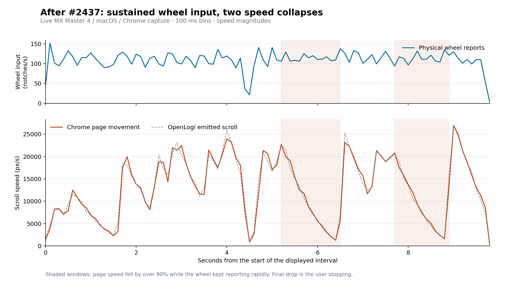
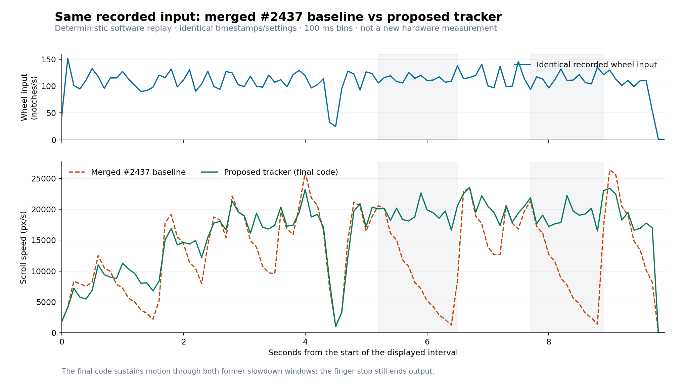
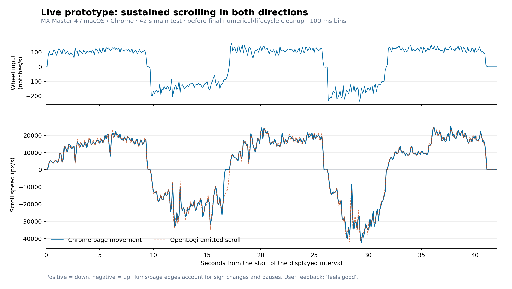

# Issue #2435 scrolling evidence

This is follow-up evidence for [#2435](https://github.com/AprilNEA/OpenLogi/issues/2435)
and the merged catch/settle fix [#2437](https://github.com/AprilNEA/OpenLogi/pull/2437).
All rates are aggregated into 100 ms bins. Wheel reports measure wheel movement,
not finger force or intent directly.

## Live capture after #2437

An MX Master 4 was repeatedly flicked in Chrome on macOS, displaying Project
Gutenberg's plain-text *Alice's Adventures in Wonderland* at 24px. Only the dev
agent was active during this capture. The source was the exact #2437 head
`6f8c88ac25bfbe69eee5d2714be59173b283df42`, whose scrolling code matches merged
master `119fc6fb2c6dcb220eaed337ada39c0986ce444f`.

At 5.2–6.4 seconds, page speed dropped from 22,720 to 1,290 px/s while wheel
input stayed at 106–129 notches/s. At 7.7–8.8 seconds, page speed dropped from
20,800 to 1,590 px/s while input stayed at 94–135 notches/s. Agent output slowed
with the page, locating the slowdown before Chrome's rendering. The last drop
at the end is the user stopping the wheel.

## Controlled software replay

The same recorded wheel reports were replayed through merged #2437 and the
proposed tracker, with identical timing and settings: 52 pixels/notch, smooth
coast shape, 15,000 px/s maximum single-spin speed, 550 ms glide length, and
150% repeat boost. The engine was advanced on a deterministic 1 ms clock.
Input timestamps are logged report-arrival times. This is a model replay,
not another measurement of Chrome or the physical mouse.

| Slowdown window | Baseline replay minimum | Proposed replay minimum |
| --- | ---: | ---: |
| 6.0–6.4 s | 1,256 px/s | 16,629 px/s |
| 8.4–8.8 s | 1,422 px/s | 16,483 px/s |

The raw reports are checked in as `sustained_flicks_recording.txt`; a second
recording, `uneven_flicks_recording.txt`, checks the intermediate speed-pulsing
problem. Both fixtures are replayed in both directions by the regression tests.

## Live wheel-driven prototype

This is the main 42-second continuous-input part of a later live session with
an earlier wheel-driven prototype. Positive speeds mean scrolling down;
negative speeds mean scrolling up. The user reported that this build "feels
good". Direction changes, finger stops, and page boundaries account for turns
and pauses; this is not a controlled same-input comparison with the first run.

The full live session included a later short scrolling burst. No backward page
frames were observed during sustained same-direction input. Most moving browser
frames were delivered near 60 Hz, with occasional missed frames. It does not
establish perfectly uniform motion in every application.

The final PR separates exact target tracking from quiet-input coasting, fixes
target/cadence bias, and ends exhausted coasts. That cleanup is covered by
recording replays and numerical/lifecycle tests; the final cleaned version has
not yet been runtime-tested on hardware. The live graph must not be read as a
measurement of that final version.

## Data and reproduction

The adjacent CSVs contain relative time and wheel/page/output rates only;
`wheel-driven-prototype-live.csv` also records page position to identify edges.
No device identifiers, account information, browser content, or absolute capture
timestamps are included. The book text is not part of these artifacts.

Run `python3 docs/diagnostics/scroll-2435/plot.py` with matplotlib installed to
regenerate the PNGs from the CSVs. The plot script was run with matplotlib 3.7.2.
The live graphs use the measured data as recorded; the software-replay graph
uses output exported by the same engine-driving harness on each version.
